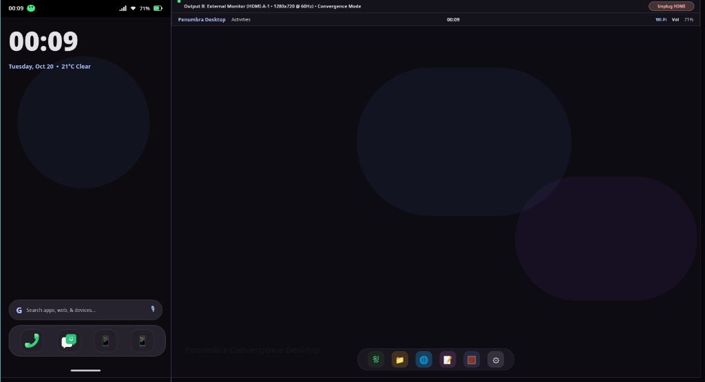
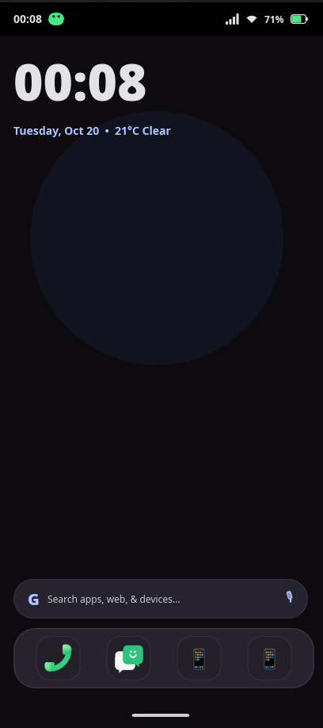
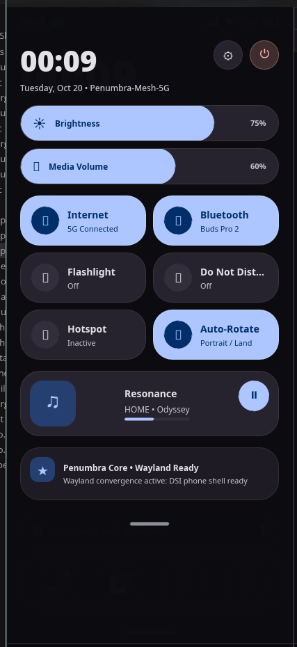
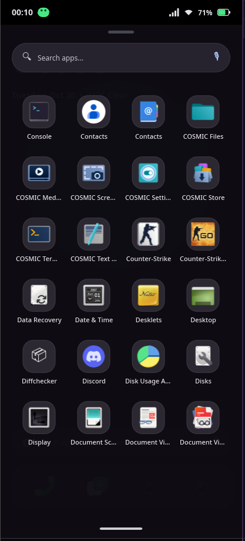
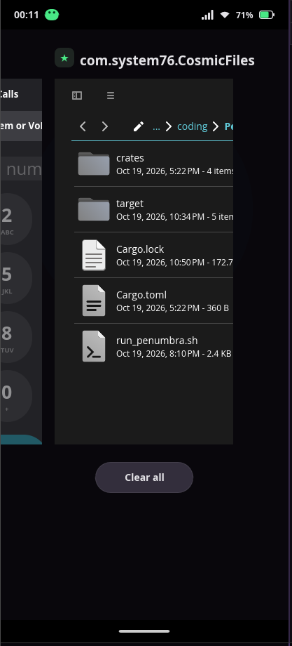

# Penumbra Mobile & Convergence Desktop Environment

<div align="center">



**A Next-Generation, 100% Rust Linux Mobile Shell & Wayland Convergence Compositor**

[](https://www.rust-lang.org/)
[](https://slint.dev/)
[](https://smithay.github.io/)
[](https://m3.material.io/)
[](#license)

</div>

---

## 🌟 Overview

**Penumbra** is a modern, mobile-first Wayland desktop environment and compositor crafted entirely in **Rust**. Combining the low-level compositor engine of **Smithay** with the reactive, GPU-accelerated UI of **Slint**, Penumbra delivers a fluid, gesture-driven smartphone user experience paired with a seamless desktop convergence mode when docked to an external monitor.

Designed under the **Material 3 Expressive** OLED pitch-black design language, Penumbra operates directly against real FreeDesktop XDG applications with zero mockup launchers or simulated window frames.

---

## 📸 Screenshots Showcase

<div align="center">

| Clean Homescreen & Dock | Quick Settings Notification Shade |
|:---:|:---:|
|  |  |
| *At-a-Glance Clock, Search Bar, and 4-Slot Bottom Dock* | *Expressive M3 Sliders, Telemetry, and Media Controls* |

| FreeDesktop XDG App Drawer | Multitasking Overview Switcher |
|:---:|:---:|
|  |  |
| *Real system apps with Long-Press Drag-and-Drop* | *Live thumbnail cards composited inside insets* |

### 🖥️ Dual-Screen Convergence Mode (Phone DSI + External HDMI)

*Simultaneous simulation: Phone Display (412x915 @ 120Hz) running alongside an external 1280x720 Desktop Monitor with dynamic task migration.*

</div>

---

## 🚀 Key Features

### 📱 1. Mobile Shell (`penumbra-shell`)
- **Clean Homescreen**: Minimalist, distraction-free desktop presenting an At-a-Glance weather/time widget, Google search pill, and persistent navigation dock.
- **Persistent Bottom Dock**:
  - Enforces a strict 4-slot mobile layout.
  - Automatically populated with GNOME Mobile app fallbacks (`Calls`, `Chatty`, `Web`, `Console`).
  - Drop rejection feedback: Attempting to drag an app onto a full dock triggers a red alert flash and shake animation.
- **Drag-and-Drop Pinning**:
  - Long press (> 400ms) on any app inside the App Drawer initiates a drag operation, minimizing the drawer to 0 opacity and tracking the floating icon under the pointer.
  - Dropping over the Homescreen grid pins the shortcut to `homescreen_apps`.
  - Dropping over the Bottom Dock pins the shortcut to `dock_apps` (if a slot is free).
- **iOS-Style "Jiggle / Edit Mode"**:
  - Press and hold any pinned shortcut for > 500ms to enter Edit Mode.
  - Pinned icons enter continuous jiggle oscillation.
  - A red circular `"✕"` badge appears at the top-right corner (`-6px, -6px`) for instant unpinning.
  - Tapping empty background space exits Edit Mode smoothly.
- **Data Persistence**:
  - User layouts are automatically serialized to and deserialized from `~/.config/penumbra/layout.json`.
  - First-boot initialization auto-detects installed web browsers, terminals, dialers, and messaging clients.

### 🪟 2. Smithay Wayland Compositor (`penumbra-comp`)
- **Dual-Output Policy Engine**:
  - **Output A (Phone DSI-1)**: Strict 412x915 mobile policy. No free-floating desktop windows; enforces fullscreen insets (`y: 42..883`), status bar overlays, and bottom gestural controls.
  - **Output B (External HDMI-A-1)**: 1280x720 convergence environment. Supports floating multi-window management, desktop docks, and window tiling.
- **Client Acceleration**: Direct EGL, GLES2, and DMA-BUF hardware acceleration. Compatible with standard Wayland toolkits (`GTK4`, `Qt6`, `libadwaita`, `iced`).

### 🌀 3. Spring Physics & Gestures (`penumbra-gestures`)
- **Damped Spring Physics**:
  - Implements second-order differential equations:
    $$F = -k \cdot x - c \cdot v$$
  - Underdamped, critically damped, and overdamped modes drive the fluid motion of the Quick Settings panel pull-down and card dismissal.
- **System Gestures**:
  - **Swipe Up Flick**: Instantly returns home from any running application.
  - **Swipe Up & Hold**: Enters the Multitasking Recents Overview.
  - **Status Bar Pull-Down**: Unfolds the Quick Settings drawer with damped overshoot.

### 🔋 4. Hardware System Services (`penumbra-services`)
- Async D-Bus integration connecting to:
  - `org.freedesktop.UPower` (Battery percentage, charging state, time remaining).
  - `org.freedesktop.NetworkManager` (Active Wi-Fi SSID, signal strength, connectivity).
  - `net.hadess.SensorProxy` (Ambient light sensor, accelerometer rotation).
- Zero-panic mock fallback service for non-Linux or desktop testing environments.

---

## 🏗️ Architecture & Workspace Structure

Penumbra is structured as a Cargo workspace with clean separation of concerns:

```
Penumbra-Shell/
├── Cargo.toml                      # Workspace manifest
├── run_penumbra.sh                 # Unified launcher script
├── assets/
│   └── screenshots/                # Visual documentation assets
└── crates/
    ├── penumbra-comp/              # Smithay Wayland compositor & policy engine
    │   ├── src/
    │   │   ├── main.rs             # CLI entrypoint
    │   │   ├── server.rs           # Smithay compositor loop & surface renderer
    │   │   ├── outputs.rs          # Multi-output policy (DSI-1 vs HDMI-A-1)
    │   │   └── phone.rs            # Phone insets & overview layout
    │   └── tests/                  # Headless compositor policy tests
    ├── penumbra-shell/             # Slint Material 3 UI shell
    │   ├── build.rs                # Slint code generator
    │   ├── src/
    │   │   ├── main.rs             # Shell event loop & Wayland connection
    │   │   ├── apps.rs             # FreeDesktop XDG app scanner & launcher
    │   │   └── config.rs           # JSON persistence (~/.config/penumbra/layout.json)
    │   └── ui/                     # Declarative Slint UI components
    │       ├── shell_root.slint    # Root dual-display window
    │       ├── app_surface.slint   # Phone display canvas & drag controller
    │       ├── app_drawer.slint    # Installed apps grid with long-press drag
    │       ├── dock.slint          # 4-slot bottom persistent dock
    │       ├── shortcut_tile.slint # App tile with jiggle animation & delete badge
    │       ├── quick_settings.slint# Drop-down quick toggles & sliders
    │       ├── desktop_surface.slint# External HDMI monitor desktop environment
    │       ├── status_bar.slint    # Telemetry status header
    │       ├── nav_bar.slint       # Bottom gesture indicator pill
    │       └── theme.slint         # Material 3 Expressive palette & tokens
    ├── penumbra-gestures/          # Standalone spring physics & touch state machines
    │   └── src/
    │       ├── spring.rs           # Second-order damped spring model
    │       ├── nav.rs              # Nav bar gesture recognizer
    │       └── touch.rs            # Velocity & displacement tracker
    └── penumbra-services/          # Hardware D-Bus & telemetry daemons
        └── src/
            ├── battery.rs          # UPower subscriber
            ├── network.rs          # NetworkManager subscriber
            └── sensor.rs           # SensorProxy subscriber
```

---

## 📦 Prerequisites & Dependencies

To build and run Penumbra on Linux, ensure the following native packages are installed:

### Ubuntu / Debian / Pop!_OS:
```bash
sudo apt update
sudo apt install -y \
    build-essential \
    pkg-config \
    libwayland-dev \
    libwayland-egl-backend-dev \
    libxkbcommon-dev \
    libfontconfig1-dev \
    libgl1-mesa-dev \
    libegl1-mesa-dev \
    libdbus-1-dev
```

### Fedora / RHEL:
```bash
sudo dnf install -y \
    gcc gcc-c++ \
    pkgconf-pkg-config \
    wayland-devel \
    libxkbcommon-devel \
    fontconfig-devel \
    mesa-libGL-devel \
    mesa-libEGL-devel \
    dbus-devel
```

### Arch Linux:
```bash
sudo pacman -S --needed \
    base-devel \
    pkgconf \
    wayland \
    libxkbcommon \
    fontconfig \
    mesa \
    dbus
```

---

## ⚡ Getting Started

### 1. Clone Repository
```bash
git clone https://github.com/penumbra-de/penumbra.git
cd penumbra
```

### 2. Build Workspace
```bash
cargo build --workspace
```

### 3. Run the Shell & Compositor
Use the included launcher script, which automatically prepares runtime sockets and launches both the compositor and shell:

```bash
./run_penumbra.sh
```

#### Launch Options:
- **Dual-Screen Simulation (Default)**: Opens both the Phone screen and External Monitor side-by-side in a nested Wayland/X11 window.
- **Phone Only**:
  ```bash
  ./target/debug/penumbra-shell --phone-only
  ```

### 4. Running the Test Suite
Penumbra contains comprehensive unit and integration tests across all four workspace crates:

```bash
cargo test --workspace
```

---

## ⚙️ Configuration & Layout Persistence

Penumbra automatically stores your personalized homescreen and dock layout in:
```
~/.config/penumbra/layout.json
```

Example schema:
```json
{
  "dock_apps": [
    "org.gnome.Calls",
    "sm.puri.Chatty",
    "firefox.desktop",
    "alacritty.desktop"
  ],
  "homescreen_apps": [
    {
      "id": "org.gnome.Nautilus.desktop",
      "x": 0,
      "y": 0
    }
  ]
}
```

---

## 📄 License

Penumbra is licensed under either of:

- Apache License, Version 2.0 ([LICENSE-APACHE](LICENSE-APACHE) or http://www.apache.org/licenses/LICENSE-2.0)
- MIT license ([LICENSE-MIT](LICENSE-MIT) or http://opensource.org/licenses/MIT)

at your option.
