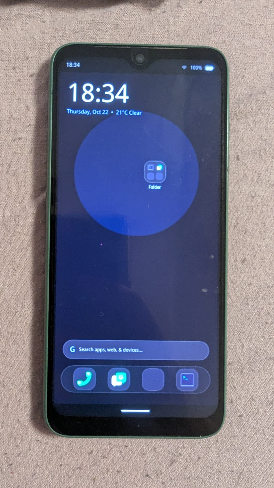

# Penumbra

**A mobile-first Linux home screen and Wayland compositor for phones, written in Rust.**

[](https://www.rust-lang.org/)
[](#license)

Penumbra is an open-source desktop environment for Linux phones. It provides a touch-first home screen, app drawer, status bar, navigation gestures and quick settings panel, and it runs ordinary Linux applications alongside them. It is built with [Rust](https://www.rust-lang.org/), the [Smithay](https://smithay.github.io/) Wayland library and the [Slint](https://slint.dev/) UI toolkit.

> **Status: early development.** Penumbra runs daily on the maintainer's phone but is not yet ready for general use. Expect rough edges and breaking changes.

## Screenshots

<div align="center">

| Home screen | App drawer | Folder | Quick settings |
|:---:|:---:|:---:|:---:|
|  |  |  |  |

**Running on a real phone**



</div>

## Features

**Home screen**
- Several pages of apps. Swipe left or right to move between them.
- Clock, date and weather at a glance on the first page.
- A bottom dock with four favourite apps, always within reach.

**Organising apps**
- Press and hold an app, then drag it to a new spot, to the dock, or onto another app.
- Drop one app onto another to create a folder. Open a folder to see its apps and rename it.
- Press and hold an icon to enter edit mode, then remove it with the badge in its corner.

**App drawer**
- Lists every installed application, read from standard Linux application entries (`.desktop` files).

**Quick settings and status**
- Pull down from the top bar to open a panel with toggles, brightness and volume sliders, and media controls.
- Battery, network and sensor information comes from the system over D-Bus (UPower, NetworkManager and SensorProxy).

**Gestures**
- Swipe up to go home from any app.
- Swipe up and hold to open the overview of running apps.

**Real Linux applications**
- Penumbra launches the programs installed on the system. Nothing is simulated.

## How it works

Penumbra is split into small Rust crates, each with one job:

| Component | Purpose |
|---|---|
| `penumbra-comp` | The Wayland compositor. Manages windows and screens and enforces the phone layout. |
| `penumbra-shell` | The user interface: home screen, app drawer, top bar, navigation bar and quick settings. |
| `layer-shell-slint` | Lets Slint draw bars and panels as Wayland layer surfaces. |
| `penumbra-gestures` | Touch handling and spring-based animation. |
| `penumbra-services` | Battery, network and sensor information over D-Bus. |
| `penumbra-greeter` | Login screen frontend for `greetd`. |

## Requirements

- Linux with a Wayland session
- Rust (stable, 2021 edition), installed with [rustup](https://rustup.rs/)
- System development libraries, listed below for common distributions

**Ubuntu / Debian / Pop!_OS**
```bash
sudo apt update
sudo apt install -y build-essential pkg-config libwayland-dev \
    libwayland-egl-backend-dev libxkbcommon-dev libfontconfig1-dev \
    libgl1-mesa-dev libegl1-mesa-dev libdbus-1-dev
```

**Fedora / RHEL**
```bash
sudo dnf install -y gcc gcc-c++ pkgconf-pkg-config wayland-devel \
    libxkbcommon-devel fontconfig-devel mesa-libGL-devel \
    mesa-libEGL-devel dbus-devel
```

**Arch Linux**
```bash
sudo pacman -S --needed base-devel pkgconf wayland libxkbcommon fontconfig mesa dbus
```

## Getting started

**1. Clone the repository**
```bash
git clone https://github.com/nyl/Penumbra-Shell.git
cd Penumbra-Shell
```

**2. Build**
```bash
cargo build --workspace
```

**3. Try it in a window**
```bash
./run_penumbra.sh
```
The script starts the compositor inside a window on your current desktop and then starts the shell inside it. This lets you try the interface without a phone.

**4. Run the tests**
```bash
cargo test --workspace
```

## Running on a phone

Penumbra targets ARM64 Linux phones and is currently tested on postmarketOS (Alpine-based). The scripts in `scripts/` cross-compile the software and copy it to the device:

1. `scripts/build-arm64-alpine.sh` builds release binaries for ARM64 inside a Docker container. Docker is required.
2. `scripts/deploy-to-device.sh --deploy-only` copies the build to the phone over SSH. Run `scripts/deploy-to-device.sh --help` to see the options, including passwords for SSH and sudo.

Deploying replaces software on the device. Only use a phone you can recover if something goes wrong.

## Configuration

The home screen layout (pages, app positions, folders and dock) is saved to `~/.config/penumbra/layout.json` and loaded when Penumbra starts.

## Project status

- **Working:** phone home screen, app drawer, folders, dock, navigation gestures, top bar and quick settings on hardware.
- **In progress:** convergence mode, which uses an external display alongside the phone screen.

## Contributing

Bug reports, ideas and pull requests are welcome. Please open an issue on GitHub first if you plan a large change.

## A note on AI assistance

Penumbra is a personal project developed with help from AI coding assistants. The maintainer reviews all changes.

## License

Penumbra is licensed under either of:

- Apache License, Version 2.0 ([LICENSE-APACHE](LICENSE-APACHE))
- MIT license ([LICENSE-MIT](LICENSE-MIT))

at your option.
