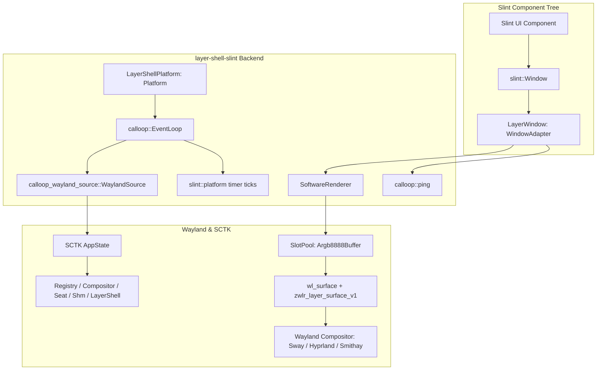

# layer-shell-slint

[](LICENSE)
[](https://www.rust-lang.org/)
[](https://slint.dev/)
[](https://wayland.freedesktop.org/)

A standalone, zero-Winit native Wayland Layer Shell (`zwlr_layer_shell_v1`) platform backend for the [Slint UI Toolkit](https://slint.dev/).

> [!NOTE]
> **Community Project Disclaimer**: `layer-shell-slint` is an independent, community-driven project and is **not** developed, maintained by, or officially affiliated with SixtyFPS GmbH or the core Slint development team. Slint is a registered trademark of SixtyFPS GmbH.

---

## Table of Contents
- [Motivation](#motivation)
- [Architecture Overview](#architecture-overview)
- [Key Features](#key-features)
- [Quick Start](#quick-start)
- [Configuration & Presets](#configuration--presets)
- [Wayland-to-Slint Dispatch Bridge](#wayland-to-slint-dispatch-bridge)
- [Software Rendering & Memory Management](#software-rendering--memory-management)
- [Running Examples](#running-examples)
- [License](#license)

---

## Motivation

Standard Slint desktop targets rely on Winit for window management and event dispatching. However, Winit is designed primarily around top-level application windows (`xdg_toplevel` / `X11`) and does not natively support Wayland desktop layer surfaces (`zwlr_layer_shell_v1`).

System UI components (such as status bars, app docks, on-screen keyboards, notifications, and lock screens) require native layer-shell features:
- Placing surfaces above or below regular windows (`Background`, `Bottom`, `Top`, `Overlay`).
- Reserving desktop workspace geometry via deterministic exclusive zones.
- Anchoring to display edges without window decorations or borders.
- Responsive touch interactions on mobile and embedded devices.

`layer-shell-slint` provides a custom [`slint::platform::Platform`](src/platform.rs) and [`slint::platform::WindowAdapter`](src/window.rs) built directly atop [Smithay Client Toolkit](https://github.com/Smithay/client-toolkit) (SCTK) and `wayland-protocols-wlr`, completely bypassing Winit.

---

## Architecture Overview



---

## Key Features

- **Zero Winit / Zero X11 Dependency**: Directly binds Wayland protocols via SCTK.
- **Configurable Layer Targeting**: Seamless placement on `Background`, `Bottom`, `Top`, or `Overlay`.
- **Flexible Edge Anchoring**: Supports any combination of `Top`, `Bottom`, `Left`, and `Right` anchors.
- **Deterministic Exclusive Zones**: Inset workspace regions to prevent application windows from overlapping system panels.
- **Zero-Copy Software Rendering**: Native `Argb8888Pixel` target pixel implementation allows Slint's `SoftwareRenderer` to paint directly into `wl_shm::SlotPool` memory without format transcoding passes.
- **VBlank Synchronized Refresh**: Redraws are gated by `wl_surface.frame()` callbacks, preventing rendering faster than display refresh rate.
- **Touch & Pointer Normalization**: Translates Wayland pointer frames and touch contacts into Slint's `WindowEvent` pipeline, ensuring `TouchArea` responds identically to finger taps and mouse clicks.

---

## Quick Start

### 1. Add Dependency to `Cargo.toml`

```toml
[dependencies]
slint = { version = "1.8", default-features = false, features = ["compat-1-2", "renderer-software", "std"] }
layer-shell-slint = { path = "crates/layer-shell-slint" }
```

### 2. Initialize Platform and Run Component

```rust
slint::slint! {
    export component TopBar inherits Window {
        height: 40px;
        background: #1e1e2e;
        HorizontalLayout {
            padding: 8px;
            Text {
                text: "Penumbra Shell Status";
                color: #cdd6f4;
                vertical-alignment: center;
            }
        }
    }
}

fn main() -> Result<(), Box<dyn std::error::Error>> {
    env_logger::init();

    // 1. Configure a top bar layer surface
    let config = layer_shell_slint::LayerConfig::top_bar(40)
        .with_namespace("penumbra-top-bar");

    // 2. Initialize custom layer shell platform backend
    layer_shell_slint::init(config)?;

    // 3. Create and drive the Slint component
    let bar = TopBar::new()?;
    bar.run()?;

    Ok(())
}
```

---

## Configuration & Presets

`LayerConfig` provides ergonomic presets and a fluent builder API:

### Presets

| Preset | Anchors | Layer | Exclusive Zone | Keyboard Interactivity |
|---|---|---|---|---|
| `LayerConfig::top_bar(height)` | `Top \| Left \| Right` | `Top` | `height` | `None` |
| `LayerConfig::bottom_panel(height)` | `Bottom \| Left \| Right` | `Top` | `height` | `None` |
| `LayerConfig::overlay()` | `Top \| Bottom \| Left \| Right` | `Overlay` | `-1` | `Exclusive` |

### Fluent Builder

```rust
use layer_shell_slint::{Anchor, KeyboardInteractivity, Layer, LayerConfig};

let config = LayerConfig::default()
    .with_namespace("desktop-dock")
    .with_layer(Layer::Bottom)
    .with_anchor(Anchor::Bottom)
    .with_size(600, 64)
    .with_margin(0, 0, 16, 0)
    .with_exclusive_zone(80)
    .with_keyboard_interactivity(KeyboardInteractivity::None);
```

---

## Wayland-to-Slint Dispatch Bridge

### Input Events (`src/input.rs`)
- **Pointer Events**:
  - `Motion` / `Enter` $\rightarrow$ `WindowEvent::PointerMoved`
  - `Press` (BTN_LEFT, BTN_RIGHT, BTN_MIDDLE) $\rightarrow$ `WindowEvent::PointerPressed`
  - `Release` $\rightarrow$ `WindowEvent::PointerReleased`
  - `Leave` $\rightarrow$ `WindowEvent::PointerExited`
  - `Axis` scroll $\rightarrow$ `WindowEvent::PointerScrolled`
- **Touch Normalization**:
  - `Down` $\rightarrow$ Emits `PointerMoved` then `PointerPressed { button: Left }`
  - `Motion` $\rightarrow$ Emits `PointerMoved`
  - `Up` / `Cancel` $\rightarrow$ Emits `PointerReleased` and `PointerExited`

### Surface Lifecycle (`src/window.rs`, `src/state.rs`)
1. Initial surface creation commits layout parameters (`zwlr_layer_surface_v1`).
2. The compositor evaluates display geometry and replies with a `configure` event.
3. The configure serial is acknowledged, updating the window adapter dimensions.
4. Redraw pass paints into a shared memory buffer from `SlotPool` and commits with `damage_buffer`.
5. Frame pacing callback (`wl_surface.frame()`) signals when the frame is presented, unblocking future redraw passes.

---

## Software Rendering & Memory Management

The crate includes [`Argb8888Pixel`](src/shm.rs), which implements Slint's `TargetPixel` trait:
- Format: Wayland `wl_shm::Format::Argb8888`.
- Layout: `[B, G, R, A]` (32-bit little-endian byte ordering).
- Shared Memory: Managed through SCTK's `SlotPool`, dynamically resizing the underlying memory-mapped file descriptor only when window surface geometry expands.

---

## Running Examples

Run the included standalone minimal bar example:

```bash
# Debug logging with full Wayland protocol wire dumps
WAYLAND_DEBUG=1 RUST_LOG=debug cargo run --package layer-shell-slint --example minimal_bar
```

---

## License

This project is licensed under the **GNU General Public License v3.0 or later** ([GPL-3.0-or-later](LICENSE)).
