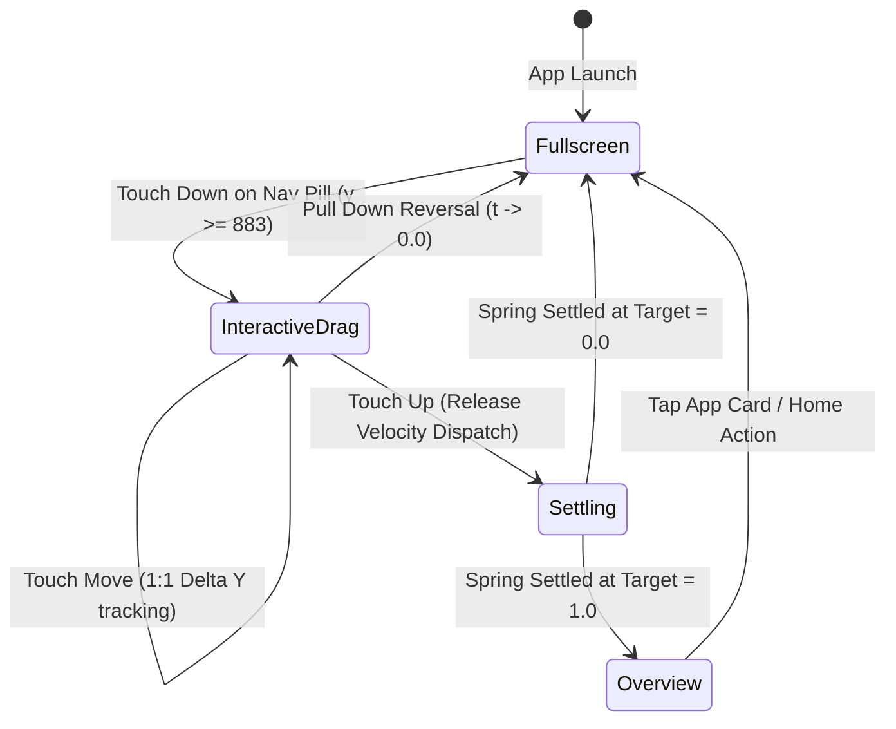

# Penumbra Mobile DE: Multitasking & Navigation Architecture

## 1. System Overview & Architectural Mandate

Penumbra Mobile DE implements authentic Android 17 (Pixel) navigation dynamics, providing 1:1 instantaneous, zero-latency touch responsiveness, bidirectional gesture cancellation, and physically simulated spring settling.

### Architectural Decision: Internal Library Crate (Option A)
To eliminate frame-pacing jitter and IPC hops between gesture detection and the Wayland compositor, `crates/penumbra-gestures` is architected as an internal library crate (`[lib]`).
- **Zero-Copy Mathematical Core:** `penumbra-gestures` provides pure mathematical formulations: [`SpringSolver`](../crates/penumbra-gestures/src/spring.rs), [`DampedHarmonicOscillator`](../crates/penumbra-gestures/src/spring.rs), [`VelocityTracker`](../crates/penumbra-gestures/src/velocity.rs), and [`GesturePhase`](../crates/penumbra-gestures/src/gesture_state.rs).
- **Direct Compositor Integration:** `penumbra-comp` directly executes physics integration in its vblank loop, ensuring that window transforms match the panel refresh rate (60/120 Hz) with $0\,\mu\text{s}$ IPC overhead.
- **Continuous 1:1 Ingress:** `penumbra-nav-bar` tracks finger coordinates continuously from the very first pixel of movement, streaming real-time normalized progress $t$ without hold timers or delayed triggers.

---

## 2. Window State Machine

The mobile application workspace transitions seamlessly through four well-defined states:



### State Specifications

| State | Normalized Progress ($t$) | Window Scale | Corner Radius | Window Offset $(X, Y)$ |
|---|---|---|---|---|
| **Fullscreen** | $t = 0.0$ | $1.0$ | $0.0\,\text{px}$ | $(0, 42)$ |
| **Interactive Drag** | $t \in [0.0, 1.05]$ | $1.0 - 0.32\,t$ | $t \times 28.0\,\text{px}$ | $(X(t), Y(t))$ |
| **Overview Card** | $t = 1.0$ | $0.68$ | $28.0\,\text{px}$ | $(66, 172)$ |

---

## 3. Mathematical Formulations

### A. Normalized Progress Calculation
During continuous touch tracking, drag displacement $\Delta Y = Y - Y_0$ ($< 0$ for upward swipe) is mapped onto the gesture active travel zone:

$$t = \mathrm{clamp}\left(\frac{-\Delta Y}{H_{\text{screen}} \times 0.45}, 0.0, 1.05\right)$$

Where $H_{\text{screen}} = 915\,\text{px}$ on the standard mobile viewport. Pulling back down toward the screen bottom reduces $-\Delta Y \to 0$, reversing $t \to 0.0$ continuously without state jumping.

### B. Window Scale & Corner Geometry
The window geometry smoothly transitions between fullscreen insets and the centered overview card slot:

$$s(t) = 1.0 - 0.32\,t$$

$$W(t) = \mathrm{round}(412 \times s(t)), \quad H(t) = \mathrm{round}(841 \times s(t))$$

$$X(t) = \frac{412 - W(t)}{2}, \quad Y(t) = \mathrm{round}(42 \times (1 - t) + 172 \times t)$$

$$r(t) = t \times 28.0\,\text{px}$$

### C. Velocity Tracking (EMA Filter)
Touch motion samples are smoothed using an Exponential Moving Average (EMA) filter with weight $\alpha = 0.8$:

$$v_k = \alpha \cdot \frac{Y_k - Y_{k-1}}{T_k - T_{k-1}} + (1 - \alpha) \cdot v_{k-1}$$

This eliminates high-frequency touchscreen digitizer jitter while preserving instantaneous flick velocity upon release.

### D. Release Arbitration (Vertical Gestures)
Upon vertical touch release, release velocity $v_y$ and progress $t$ arbitrate the target:

$$\text{Target} = \begin{cases}
\text{Home}, & v_y < -500\,\text{px/s} \quad (\text{fast upward flick dismisses app to home}) \\
\text{Fullscreen}, & v_y > 500\,\text{px/s} \quad (\text{downward pull cancels back to active app}) \\
\text{Overview}, & |v_y| \le 500\,\text{px/s} \text{ and } t \ge 0.35 \quad (\text{drag & hold or deliberate release}) \\
\text{Fullscreen}, & |v_y| \le 500\,\text{px/s} \text{ and } t < 0.35 \quad (\text{sub-threshold release})
\end{cases}$$

### E. Quick Switch Lateral Window Cycling (Horizontal Gestures)
When dragging horizontally along the navigation bar ($|\Delta X| > 15\,\text{px}$ and horizontally dominant $|\Delta X| > |\Delta Y| \cdot 1.1$):
- **Real-Time Translation:** The active application translates laterally by $\Delta X$.
- **Adjacent Task Ingress:** If $\Delta X > 0$ (swiping right), the previous application card enters smoothly from the left at $X = \Delta X - W_{\text{screen}}$. If $\Delta X < 0$ (swiping left), the next application card enters from the right at $X = \Delta X + W_{\text{screen}}$.
- **Lateral Arbitration:**
  $$\text{Target} = \begin{cases}
  \text{NextApp}, & v_x < -350\,\text{px/s} \text{ or } \Delta X < -(W_{\text{screen}} \times 0.25) \\
  \text{PrevApp}, & v_x > 350\,\text{px/s} \text{ or } \Delta X > (W_{\text{screen}} \times 0.25) \\
  \text{Fullscreen}, & \text{otherwise} \quad (\text{cancel back to current app})
  \end{cases}$$

### F. Damped Harmonic Oscillator (Spring Physics)
The settling animation is integrated analytically using the closed-form damped oscillator:

$$m \ddot{x} + c \dot{x} + k (x - x_{\text{target}}) = 0 \iff F = -k (x - x_{\text{target}}) - c v$$

- **Overview Preset:** $k = 300.0\,\text{N/m}, c = 28.0\,\text{N}\cdot\text{s/m}, m = 1.0\,\text{kg}, \zeta = \frac{28.0}{2\sqrt{300.0}} \approx 0.8083$ (authentic Material underdamped decay).
- **Home Dismiss Preset:** $k = 340.0\,\text{N/m}, c = 29.0\,\text{N}\cdot\text{s/m}, m = 1.0\,\text{kg}, \zeta \approx 0.7864$ (fast, snappy, energetic dismiss into home launcher).
- **Quick Switch Lateral Preset:** $k = 280.0\,\text{N/m}, c = 27.0\,\text{N}\cdot\text{s/m}, m = 1.0\,\text{kg}, \zeta \approx 0.8068$ (smooth gliding card transition).

---

## 4. GLES Render Passes & Composition Pipeline

Compositing occurs in strict bottom-to-top order within each frame:

```
+-------------------------------------------------------------+
| LAYER 5: Overlay (Quick Settings, Power Dialog, Modals)     |
+-------------------------------------------------------------+
| LAYER 4: Top Layer-Shell (Status Bar, Nav Bar Pill)         |
+-------------------------------------------------------------+
| LAYER 3: Transforming App Card / Overview Carousel Cards    |
+-------------------------------------------------------------+
| LAYER 2: Material 3 Dimming Scrim (#0b0a0e, alpha = 0.45*t) |
+-------------------------------------------------------------+
| LAYER 1: Pre-Blurred Wallpaper (Dual-Kawase 1/4 Resolution)  |
+-------------------------------------------------------------+
| LAYER 0: Deep Slate Background Canvas (#0a080e)             |
+-------------------------------------------------------------+
```

### Pre-Blurred Wallpaper Cache
At compositor startup, [`BlurredWallpaperCache`](../crates/penumbra-comp/src/wallpaper_blur.rs) downsamples the wallpaper to $103 \times 228$ ($1/4$ resolution) and executes a 3-iteration dual-kawase blur filter. This eliminates runtime GPU blur passes during window scaling, maintaining rock-solid 60/120 FPS.

### Dimming Scrim Pass
During interactive drag or spring settling ($t > 0.001$), a solid scrim element (`#0b0a0e`) with alpha $\alpha_{\text{scrim}} = \mathrm{clamp}(0.45 \times t, 0.0, 0.45)$ is composited between the wallpaper and the active window card. For dismiss-to-home transitions, scrim alpha smoothly fades away as the card recedes into the home screen.

---

## 5. Dual Input Ingress Arbitration

Penumbra supports two zero-latency input paths:
1. **Direct Native Ingress (`native_input.rs`):** In DRM/KMS mode, touches starting at $y \ge 883\,\text{px}$ are tracked directly by the compositor with $0\,\mu\text{s}$ latency.
2. **Layer-Shell Ingress (`penumbra-nav-bar`):** When running the standalone navigation bar client on Wayland `zwlr_layer_shell_v1`, continuous updates $(\Delta X, \Delta Y, v_x, v_y, t)$ are written to `ShellState` and polled synchronously by the compositor on every render tick.

